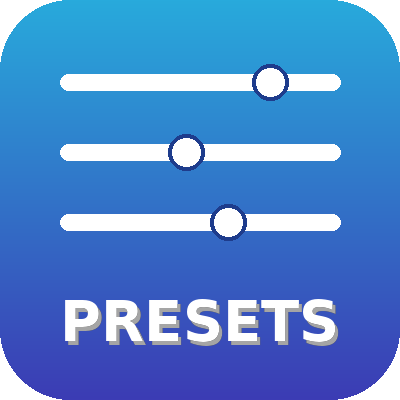

# LoRA Preset (saved in workflow)

Pick a whole LoRA combination (files + strengths) from **one dropdown**.
Presets are stored **inside the node, in the workflow** – when you share the workflow, your presets go with it. No preset files on disk.



## Usage
`Load Diffusion Model` → **LoRA Preset (saved in workflow)** → sampler / guider

- **preset** – the LoRA combo to apply
- **strength_multiplier** – scales all strengths of the preset (1.0 = as saved)
- outputs: `MODEL`, `info` (text with the LoRAs actually applied)

Model-only LoRAs (no CLIP), like `LoraLoaderModelOnly`.

## Right-click menu
| | |
|---|---|
| 💾 **Save enabled LoRAs as preset…** | Collects every **enabled** `LoraLoaderModelOnly` / `LoraLoader` in the graph (with strengths), asks for a name. LoRAs that already feed *into* this node (e.g. a character LoRA before it) are skipped. |
| ✏️ **Edit all presets (JSON)…** | Edit everything in one window |
| 📥 **Import / paste presets…** | Paste presets someone shared with you |
| 📋 **Copy preset to clipboard** | Share one preset as text |
| 🔤 **Rename** / 🗑️ **Delete** | For the selected preset |

The dropdown updates immediately. Save the workflow (Ctrl+S) to keep your presets.

## Preset format
```json
{
  "Natural": [["Famegrid_Standard_Krea2.safetensors", 0.6], ["real_3d_krea2_loraholic.safetensors", 0.6]],
  "No LoRA": []
}
```

## Notes
- The LoRA **files** are not included in a preset – everyone needs them in `models/loras`. A missing file is reported by name.
- Tip: combine it with a switch (e.g. `Switch` node) to choose between manual LoRA loaders and the preset.

## Install
ComfyUI Manager → search **LoRA Preset (saved in workflow)**, or
`comfy node install comfyui-workflow-lora-presets`

## License
MIT
